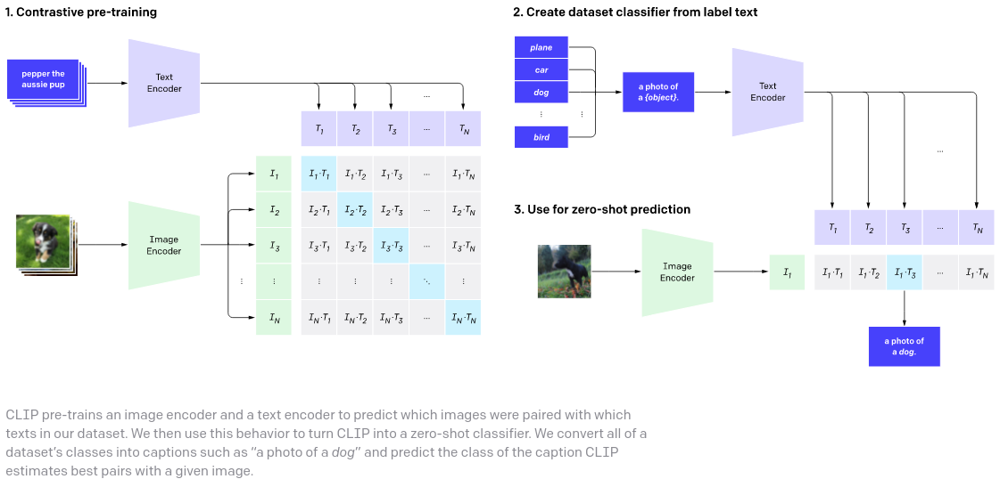

</img>

<a href="https://discord.gg/xBPBXfcFHd"></a>

## x-clip

A concise but complete implementation of <a href="https://openai.com/blog/clip/">CLIP</a> with various experimental improvements from recent papers

## Install

```bash
$ pip install x-clip
```

## Usage

```python
import torch
from x_clip import CLIP

clip = CLIP(
    dim_text = 512,
    dim_image = 512,
    dim_latent = 512,
    num_text_tokens = 10000,
    text_enc_depth = 6,
    text_seq_len = 256,
    text_heads = 8,
    visual_enc_depth = 6,
    visual_image_size = 256,
    visual_patch_size = 32,
    visual_heads = 8,
    visual_patch_dropout = 0.5,             # patch dropout probability (FLIP); 0.5 is a good default, 0.75 is tolerable
    use_all_token_embeds = False,           # fine-grained contrastive learning (FILIP)
    decoupled_contrastive_learning = True,  # decoupled contrastive learning (DCL); drop the positive term from the InfoNCE denominator
    extra_latent_projection = True,         # separate projections for text-to-image and image-to-text (CLOOB)
    use_visual_ssl = True,                  # self-supervised learning on images
    use_mlm = False,                        # masked language modeling on text (DeCLIP)
    text_ssl_loss_weight = 0.05,            # weight for the text MLM loss
    image_ssl_loss_weight = 0.05            # weight for the image SSL loss
)

# mock data

text = torch.randint(0, 10000, (4, 256))
images = torch.randn(4, 3, 256, 256)

# train

loss = clip(
    text,
    images,
    freeze_image_encoder = False,   # freeze the image encoder, as in LiT
    return_loss = True              # needs to be True to return the contrastive loss
)

loss.backward()
```

You can also pass in an external image encoder. It must return embeddings shaped `batch x seq x dim`, with `dim_image` set to the embedding dimension. Here is an example using `vit_pytorch`:

```bash
$ pip install vit_pytorch>=0.25.6
```

```python
import torch
from x_clip import CLIP

from vit_pytorch import ViT
from vit_pytorch.extractor import Extractor

base_vit = ViT(
    image_size = 256,
    patch_size = 32,
    num_classes = 1000,
    dim = 512,
    depth = 6,
    heads = 16,
    mlp_dim = 2048,
    dropout = 0.1,
    emb_dropout = 0.1
)

vit = Extractor(
    base_vit,
    return_embeddings_only = True
)

clip = CLIP(
    image_encoder = vit,
    dim_image = 512,           # must match the vision transformer's output dimension
    dim_text = 512,
    dim_latent = 512,
    num_text_tokens = 10000,
    text_enc_depth = 6,
    text_seq_len = 256,
    text_heads = 8
)

text = torch.randint(0, 10000, (4, 256))
images = torch.randn(4, 3, 256, 256)

loss = clip(text, images, return_loss = True)
loss.backward()
```

The text encoder can be external as well. It must return token embeddings with the CLS token first.

```python
import torch
from x_clip import CLIP, TextTransformer

from vit_pytorch import ViT
from vit_pytorch.extractor import Extractor

base_vit = ViT(
    image_size = 256,
    patch_size = 32,
    num_classes = 1000,
    dim = 512,
    depth = 6,
    heads = 16,
    mlp_dim = 2048,
    dropout = 0.1,
    emb_dropout = 0.1
)

image_encoder = Extractor(
    base_vit,
    return_embeddings_only = True
)

text_encoder = TextTransformer(
    dim = 512,
    num_tokens = 10000,
    max_seq_len = 256,
    depth = 6,
    heads = 8,
    dim_head = 64
)

clip = CLIP(
    image_encoder = image_encoder,
    text_encoder = text_encoder,
    dim_image = 512,
    dim_text = 512,
    dim_latent = 512
)

text = torch.randint(0, 10000, (4, 256))
images = torch.randn(4, 3, 256, 256)

loss = clip(text, images, return_loss = True)
loss.backward()
```

## Multiview CL Losses

This repository also supports multiview contrastive learning loss, as proposed in <a href="https://arxiv.org/abs/2110.05208">DeCLIP</a>. Pass in augmented text and/or images, and the loss is added automatically, weighted by `multiview_loss_weight`.

For example:

```python
import torch
from x_clip import CLIP, TextTransformer

from vit_pytorch import ViT
from vit_pytorch.extractor import Extractor

base_vit = ViT(
    image_size = 256,
    patch_size = 32,
    num_classes = 1000,
    dim = 512,
    depth = 6,
    heads = 16,
    mlp_dim = 2048,
    dropout = 0.1,
    emb_dropout = 0.1
)

image_encoder = Extractor(
    base_vit,
    return_embeddings_only = True
)

text_encoder = TextTransformer(
    dim = 512,
    num_tokens = 10000,
    max_seq_len = 256,
    depth = 6,
    heads = 8,
    dim_head = 64
)

clip = CLIP(
    image_encoder = image_encoder,
    text_encoder = text_encoder,
    dim_image = 512,
    dim_text = 512,
    dim_latent = 512,
    extra_latent_projection = True,
    multiview_loss_weight = 0.1         # weight multiview contrastive loss by 0.1
)

text = torch.randint(0, 10000, (4, 256))
images = torch.randn(4, 3, 256, 256)

aug_text = torch.randint(0, 10000, (4, 256))  # augmented text (backtranslation or EDA), same shape as text
aug_image = torch.randn(4, 3, 256, 256)       # augmented image, same shape as images
loss = clip(
    text,
    images,
    aug_text = aug_text,           # pass in augmented text
    aug_image = aug_image,         # pass in augmented image
    return_loss = True,
    freeze_image_encoder = True
)

loss.backward()
```

You can also pass multiple augmented views per modality:

```python
# ...

aug_texts = (
    torch.randint(0, 10000, (4, 256)),
    torch.randint(0, 10000, (4, 256)),
)

aug_images = (
    torch.randn(4, 3, 256, 256),
    torch.randn(4, 3, 256, 256),
)

loss = clip(
    text,
    images,
    aug_text = aug_texts,
    aug_image = aug_images,
    return_loss = True,
    freeze_image_encoder = True
)

loss.backward()
```

## Additional Loss Terms

Each term is optional and off by default.

| argument | term |
| --- | --- |
| `sim_reg_loss_weight` | matches intra-modal similarity statistics across paired modalities (Shi et al.) |
| `spectral_loss_weight` | spectral contrastive loss on paired latents (HaoChen et al.); incompatible with `use_all_token_embeds` |
| `asymmetric_infonce` | drops one direction of the symmetric InfoNCE average |
| `logsumexp_reg_loss_weight` | logsumexp regularizer on the similarity rows (CRL); requires `asymmetric_infonce = True` |
| `negative_mse_loss_weight` | MSE penalty on negative similarities |

## Custom Vision Self-supervised Learning Module

You can pass your own vision self-supervised learning module through the `visual_ssl` keyword:

```python
import torch
from x_clip import CLIP
from x_clip.visual_ssl import SimSiam

from vit_pytorch import ViT
from vit_pytorch.extractor import Extractor

base_vit = ViT(
    image_size = 256,
    patch_size = 32,
    num_classes = 1000,
    dim = 512,
    depth = 6,
    heads = 16,
    mlp_dim = 2048,
    dropout = 0.1,
    emb_dropout = 0.1
)

image_encoder = Extractor(
    base_vit,
    return_embeddings_only = True
)

visual_ssl = SimSiam(                 # accepts images shaped like CLIP's and returns a scalar loss
    image_encoder,
    image_size = 256,
    hidden_layer = -1
)

clip = CLIP(
    image_encoder = image_encoder,
    dim_image = 512,
    dim_text = 512,
    dim_latent = 512,
    visual_ssl = visual_ssl            # external SSL module
)

text = torch.randint(0, 10000, (4, 256))
images = torch.randn(4, 3, 256, 256)

loss = clip(text, images, return_loss = True)
loss.backward()
```

## Citations

```bibtex
@misc{zhang2020convirt,
    title   = {Contrastive Learning of Medical Visual Representations from Paired Images and Text},
    author  = {Yuhao Zhang and Hang Jiang and Yasuhide Miura and Christopher D. Manning and Curtis P. Langlotz},
    year    = {2020},
    eprint  = {2010.00747},
    archivePrefix = {arXiv},
    primaryClass = {cs.CV}
}

@misc{radford2021learning,
    title   = {Learning Transferable Visual Models From Natural Language Supervision},
    author  = {Alec Radford and Jong Wook Kim and Chris Hallacy and Aditya Ramesh and Gabriel Goh and Sandhini Agarwal and Girish Sastry and Amanda Askell and Pamela Mishkin and Jack Clark and Gretchen Krueger and Ilya Sutskever},
    year    = {2021},
    eprint  = {2103.00020},
    archivePrefix = {arXiv},
    primaryClass = {cs.CV}
}

@misc{yao2021filip,
    title   = {FILIP: Fine-grained Interactive Language-Image Pre-Training},
    author  = {Lewei Yao and Runhui Huang and Lu Hou and Guansong Lu and Minzhe Niu and Hang Xu and Xiaodan Liang and Zhenguo Li and Xin Jiang and Chunjing Xu},
    year    = {2021},
    eprint  = {2111.07783},
    archivePrefix = {arXiv},
    primaryClass = {cs.CV}
}

@misc{fürst2021cloob,
    title   = {CLOOB: Modern Hopfield Networks with InfoLOOB Outperform CLIP},
    author  = {Andreas Fürst and Elisabeth Rumetshofer and Viet Tran and Hubert Ramsauer and Fei Tang and Johannes Lehner and David Kreil and Michael Kopp and Günter Klambauer and Angela Bitto-Nemling and Sepp Hochreiter},
    year    = {2021},
    eprint  = {2110.11316},
    archivePrefix = {arXiv},
    primaryClass = {cs.LG}
}

@misc{yeh2021decoupled,
    title   = {Decoupled Contrastive Learning},
    author  = {Chun-Hsiao Yeh and Cheng-Yao Hong and Yen-Chi Hsu and Tyng-Luh Liu and Yubei Chen and Yann LeCun},
    year    = {2021},
    eprint  = {2110.06848},
    archivePrefix = {arXiv},
    primaryClass = {cs.LG}
}

@misc{zhai2021lit,
    title   = {LiT: Zero-Shot Transfer with Locked-image Text Tuning},
    author  = {Xiaohua Zhai and Xiao Wang and Basil Mustafa and Andreas Steiner and Daniel Keysers and Alexander Kolesnikov and Lucas Beyer},
    year    = {2021},
    eprint  = {2111.07991},
    archivePrefix = {arXiv},
    primaryClass = {cs.CV}
}

@misc{li2021supervision,
    title   = {Supervision Exists Everywhere: A Data Efficient Contrastive Language-Image Pre-training Paradigm},
    author  = {Yangguang Li and Feng Liang and Lichen Zhao and Yufeng Cui and Wanli Ouyang and Jing Shao and Fengwei Yu and Junjie Yan},
    year    = {2021},
    eprint  = {2110.05208},
    archivePrefix = {arXiv},
    primaryClass = {cs.CV}
}

@Article{mu2021slip,
    author  = {Norman Mu and Alexander Kirillov and David Wagner and Saining Xie},
    title   = {SLIP: Self-supervision meets Language-Image Pre-training},
    journal = {arXiv preprint arXiv:2112.12750},
    year    = {2021},
}

@misc{su2021roformer,
    title   = {RoFormer: Enhanced Transformer with Rotary Position Embedding},
    author  = {Jianlin Su and Yu Lu and Shengfeng Pan and Bo Wen and Yunfeng Liu},
    year    = {2021},
    eprint  = {2104.09864},
    archivePrefix = {arXiv},
    primaryClass = {cs.CL}
}

@misc{shleifer2021normformer,
    title   = {NormFormer: Improved Transformer Pretraining with Extra Normalization},
    author  = {Sam Shleifer and Jason Weston and Myle Ott},
    year    = {2021},
    eprint  = {2110.09456},
    archivePrefix = {arXiv},
    primaryClass = {cs.CL}
}

@inproceedings{Li2023ScalingLP,
    title   = {Scaling Language-Image Pre-training via Masking},
    author  = {Yanghao Li and Haoqi Fan and Ronghang Hu and Christoph Feichtenhofer and Kaiming He},
    booktitle = {Proceedings of the IEEE/CVF Conference on Computer Vision and Pattern Recognition (CVPR)},
    year    = {2023}
}

@article{Liu2022PatchDropoutEV,
    title   = {PatchDropout: Economizing Vision Transformers Using Patch Dropout},
    author  = {Yue Liu and Christos Matsoukas and Fredrik Strand and Hossein Azizpour and Kevin Smith},
    journal = {ArXiv},
    year    = {2022},
    volume  = {abs/2208.07220}
}

@misc{shi2023enhance,
    title   = {Enhance audio generation controllability through representation similarity regularization},
    author  = {Yangyang Shi and Gael Le Lan and Varun Nagaraja and Zhaoheng Ni and Xinhao Mei and Ernie Chang and Forrest Iandola and Yang Liu and Vikas Chandra},
    year    = {2023},
    eprint  = {2309.08773},
    archivePrefix = {arXiv},
    primaryClass = {cs.SD}
}

@inproceedings{hao2021provable,
    title   = {Provable Guarantees for Self-Supervised Deep Learning with Spectral Contrastive Loss},
    author  = {Jeff Z. HaoChen and Colin Wei and Adrien Gaidon and Tengyu Ma},
    booktitle = {Advances in Neural Information Processing Systems},
    year    = {2021},
    eprint  = {2106.04156},
    archivePrefix = {arXiv},
    primaryClass = {cs.LG}
}

@inproceedings{eysenbach2022contrastive,
    title   = {Contrastive Learning as Goal-Conditioned Reinforcement Learning},
    author  = {Benjamin Eysenbach and Tianjun Zhang and Sergey Levine and Ruslan Salakhutdinov},
    booktitle = {Advances in Neural Information Processing Systems},
    year    = {2022},
    eprint  = {2206.07568},
    archivePrefix = {arXiv},
    primaryClass = {cs.LG}
}

@misc{guzhov2021audioclip,
    title   = {AudioCLIP: Extending CLIP to Image, Text and Audio},
    author  = {Andrey Guzhov and Federico Raue and Jörn Hees and Andreas Dengel},
    year    = {2021},
    eprint  = {2106.13043},
    archivePrefix = {arXiv},
    primaryClass = {cs.SD}
}

@misc{theisen2024nmodal,
    title   = {N-Modal Contrastive Losses with Applications to Social Media Data in Trimodal Space},
    author  = {William Theisen and Walter Scheirer},
    year    = {2024},
    eprint  = {2403.12747},
    archivePrefix = {arXiv},
    primaryClass = {cs.CV}
}
```

